<div align="center">
  
</div>

# ssrf-scanner

A bounded, same-origin probe sender for SSRF testing on systems you are authorized to assess.

## Safety and limits

- Every run requires `--authorized` and an exact `--allow-host` match.
- The probe value must be an absolute HTTP(S) URL with the same scheme, hostname, and port as the target. The scanner does not provide metadata, private-address, alternate-protocol, or callback payloads.
- The scanner sends one GET per selected query parameter, allows at most 20 parameters and five concurrent requests, caps each request timeout at 10 seconds, and reads at most 4 KiB of response content.
- Client-side redirects and environment-configured proxies are disabled. The target application may independently follow a same-origin probe URL's redirects; use a harmless endpoint you control that is known not to redirect.
- A response that reflects the probe URL is reported only as a **heuristic indication**. Reflection is not proof that the server made a request; this tool never reports confirmed SSRF. Confirm behavior through authorized server-side logs or other in-scope observability.

## Usage

Choose a harmless, non-redirecting URL on the exact origin of the authorized endpoint:

```text
python ssrf_scanner.py "https://owned.example/proxy?url=" `
  --probe-url "https://owned.example/robots.txt" `
  --allow-host owned.example `
  --authorized
```

PowerShell users can put the command on one line or use PowerShell's backtick for line continuation. On macOS/Linux, replace the backticks with `\`.

If parameters are not present in the target query string, select them explicitly:

```text
python ssrf_scanner.py "https://owned.example/proxy" `
  --probe-url "https://owned.example/robots.txt" `
  --allow-host owned.example `
  --authorized `
  --params url
```

Optional controls include `--threads` (1-5, default 2), `--timeout` (up to 10 seconds, default 5), repeatable `--header "Name: Value"`, and `--out results.json`. The scanner rejects `Host` and transport headers that could confuse request scope.

## Local tests

The tests use only a local HTTP fixture and make no external requests:

```text
python -m unittest discover -s tests -v
```

## Disclaimer

Use only with explicit authorization and within the owner's defined scope. The operator is responsible for choosing a safe same-origin probe endpoint and ensuring the target application's behavior is in scope.

## Author

**Omar Khalid** — [omareldemery.com](https://omareldemery.com) | [@amooryx](https://github.com/amooryx)
